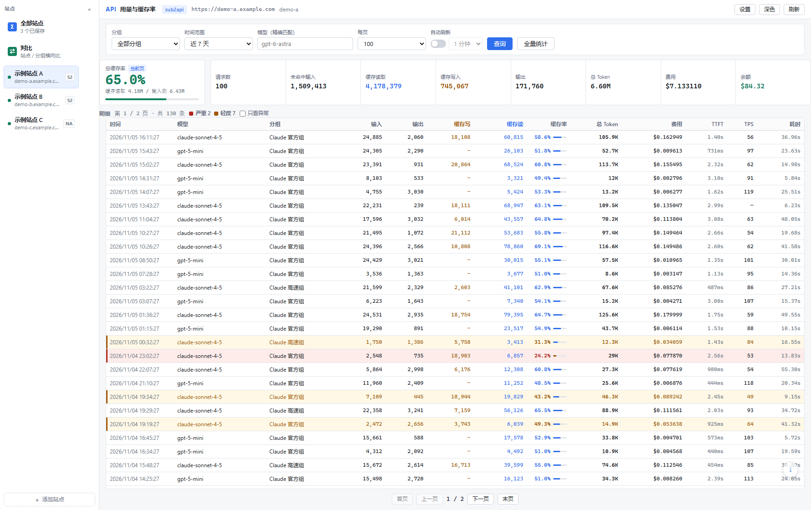
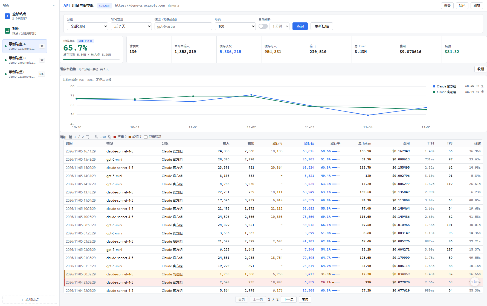
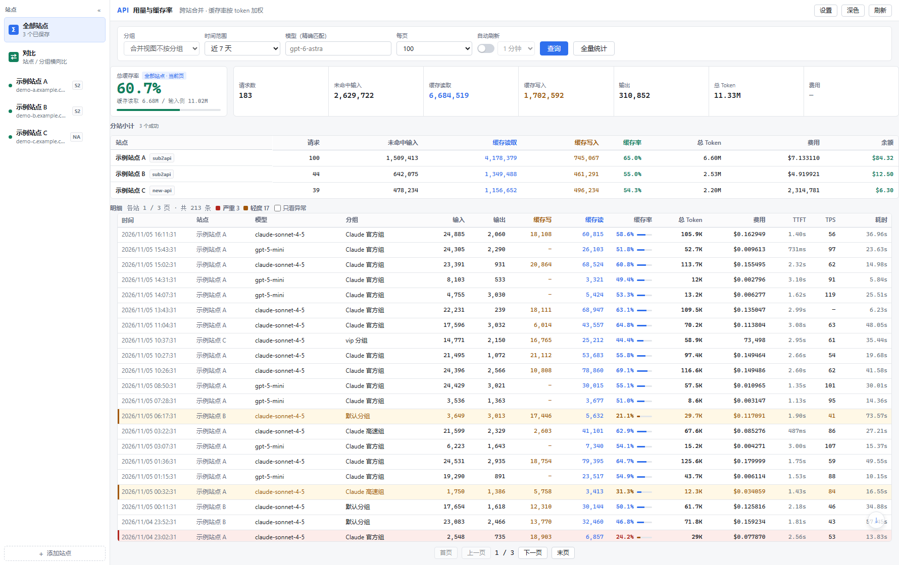
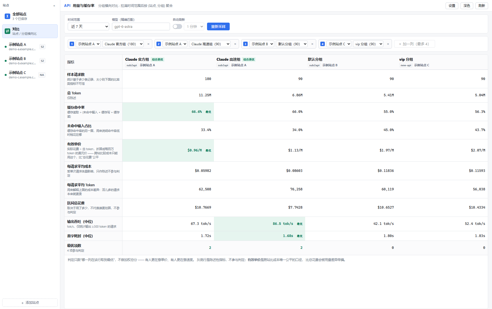
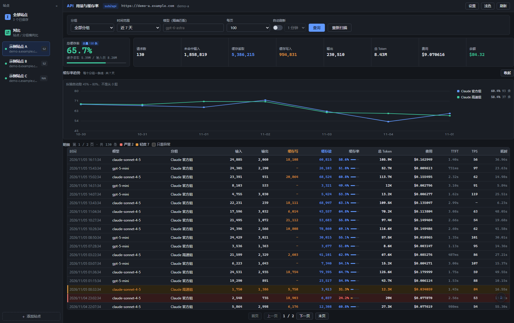

# API Show

Windows 桌面工具：填中转站点的地址和凭据，拿到每条调用记录的**缓存命中率**和 token 构成，并把多个站点、多个分组放进一张表横向对比。

起因是不少 [sub2api](https://github.com/Wei-Shaw/sub2api) / new-api 站点的用量页只给 `总 tokens`，不给缓存率。而它们的用户态接口 `/api/v1/usage` 其实四个字段都返回了——工具做的就是把口径统一，然后算给你看。

**下载**：[Releases / v0.1.0](https://github.com/s88868888/sub2api-cache-viewer/releases/tag/v0.1.0)（便携版 105 MiB，无代码签名，首次运行需在 SmartScreen 里点「更多信息 → 仍要运行」）



## 缓存率的口径

分母必须带上**缓存写入**，否则写入密集的时段会显得命中率虚高：

```
cacheRate = cache_read / (uncached_input + cache_creation + cache_read)
```

两家后台的字段口径不同，适配器在归一化时就换算掉了，所以 `inputTokens` 在本工具里恒等于「未命中缓存的输入」：

| 站点 | 原始字段 | 处理 |
| --- | --- | --- |
| sub2api | `input / cache_creation / cache_read / output` | `input` 本来就不含缓存，四项直接相加得总量 |
| new-api | `prompt_tokens` + `other.cache_tokens` | OpenAI 系的 `prompt_tokens` **已含**缓存，够减就减；不够减（Anthropic 系）就原样当未命中输入 |

## 全量统计与趋势

明细表是分页的，所以默认汇总只累加**当前这一页**——时间范围拉到 7 天却只统计了头 100 条，这个数字会骗人。点「全量统计」会把时间范围内的记录连续翻页拉完（每站上限 4000 条，触顶就在徽章上标「已截断」），顶部汇总、分站小计和趋势图一起改用全量口径重算，三个数字不会各说各话。

扫描结果按「站点 + 时间范围 + 模型」缓存 60 秒，和「对比」共用同一份采样，来回切换不重复打接口。

顺手画出缓存率的日粒度趋势：单站点视图每个分组一条线，合并视图每个站点一条线。没有记录的日期**断线**而不是连过去，否则「停用了一周」会被画成「缓存崩了」。纵轴跟着数据取值域，并在图上写明不是从 0 起——常年在 60~75% 之间晃的指标，用 0~100 的轴等于没画。



## 跨站合并

多个站点的 token 按加权合并，费用只在单位一致时才求和——sub2api 记美元、new-api 记 quota，混在一起算出来的数字是假的，所以宁可留空并说明原因。



## 横向对比

任意 `(站点, 分组)` 组合并列，逐行标出最优，参考车评那种读法。11 行指标里只有 4 行参与「谁更优」的判定：缓存命中率、有效单价、输出吞吐、首字耗时。其余只陈述不评分——请求数、区间总花费这种东西，大不等于差。

综合结论只数「哪一列在更多行拿到最优」，不做加权总分，因为每个人更在意的不一样。取不到数据的行既不判最优也不判最差，否则一个换算不出美元的站点会因为「没有值」而输掉整行。



## 异常判定

判定挂在 `站点 + 模型 + 分组` 的桶里，拿组内**中位数**做基线——不同模型、不同分组的倍率本来就没法比。

- **缓存率**：比组内中位数低 15 个百分点 → 黄，低 40 个百分点 → 红
- **输出吞吐**：比组内中位数慢 1.8 倍 → 黄，慢 2.8 倍 → 红
- 偏高、偏快是好事，不标色

吞吐用的是 **TPS（输出 token / 秒）**而不是原始耗时。耗时跟输出量线性相关，拿输出 3500 token 的记录去跟输出 200 的比谁慢，比的其实是谁活儿多。同理跨站也不比总花费，比的是折算到每百万 token 的有效单价。

两条刻意的限制：同组样本不足 5 条不判定（界面会写「样本不足」，免得你把「没标色」读成「没异常」）；输出少于 300 token 的请求不计入 TPS，因为首字耗时会主导比值。

## 拿凭据的三种方式

面板接口只认登录态 JWT，`sk-` 开头的 API key 读不到用量记录，所以得先拿到面板 token。

| 方式 | 说明 | 什么时候用 |
| --- | --- | --- |
| 邮箱密码 | 调各站登录接口（sub2api `/api/v1/auth/login`，2FA 走 `/auth/login/2fa`；new-api `/api/user/login`） | 站点没上人机验证 |
| 内置浏览器 | 打开真实登录页，你手动过完验证，主进程从请求头截获 JWT | 站点挂了 Cloudflare Turnstile，纯 HTTP 登录必然失败 |
| 粘贴 JWT | 从浏览器 DevTools 复制面板 token | 前两种都不顺手时兜底 |

## 暗色模式与界面



侧栏可折叠、明细列可配置、自动刷新、每页条数自定义（5 档预设 + 自定义输入）、底部常驻横向滚动条。

## 安全边界

- 面板窗口加载的是第三方站点，所以**不挂本应用的 preload**——否则等于把 `apiShow` 的 IPC 桥交给外部页面。另外 `sandbox: true` + `contextIsolation: true` + `nodeIntegration: false`，导航限制在该站点自己的域名内，站外链接一律交系统浏览器，登录态只写进独立的 `persist:panel` 分区
- 密文和 JWT 只留在主进程。渲染层拿到的站点档案只有 `hasPassword` / `hasJwt` 两个布尔值，凭据不跨 IPC 回流
- 数据都在本机 `userData`（打包后 `%APPDATA%\API Show\`，dev 下 `%APPDATA%\api-show\`）：`sites.json` 里的密码是 `safeStorage`（Windows DPAPI）加密后的密文，只在本机本用户可解；系统不支持加密时干脆不存

## 开发

需要 Node 20+ 和 pnpm。`.npmrc` 配了 npmmirror 的 Electron 镜像，海外环境删掉那两行即可。

```bash
pnpm install
pnpm dev          # 热更新
pnpm typecheck    # tsc 查主进程，vue-tsc 查渲染层
pnpm dist         # 打包 portable + NSIS，产物在 dist/
```

`pnpm install` 后若 `node_modules/electron/dist/` 是空的（pnpm 默认拦 postinstall），补跑 `node node_modules/electron/install.js`。

## 已知限制

- 明细表上方的汇总默认只覆盖**当前页**；要覆盖整个时间范围点一次「全量统计」，它会连续翻页采样
- 全量统计和对比都是每站最多 4000 条采样，触顶会明确标「已截断」，不假装统计完了
- OpenAI 系上游没有 Anthropic 那种显式缓存写入计费，`cache_creation` 返回 0 是正常的，不是丢数据
- new-api 拿不到 `quota_per_unit` 时成本换算不出美元，该站成本列不参与对比
- 只在 Windows x64 实测过；README 截图里的站点、分组和数字全是合成演示数据
